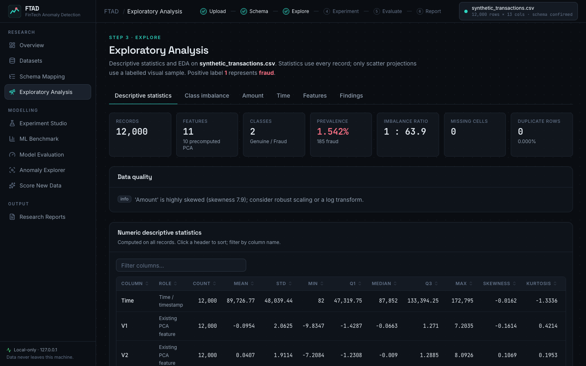
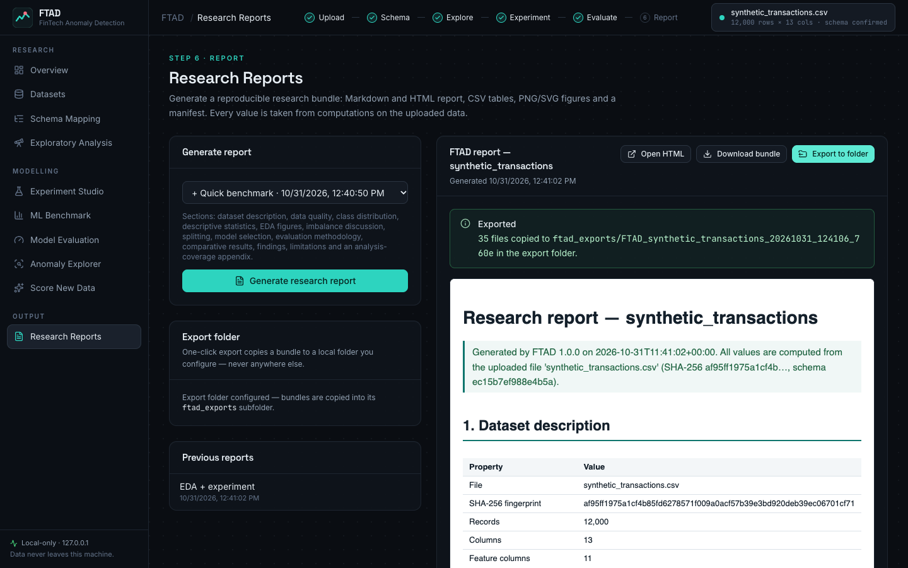
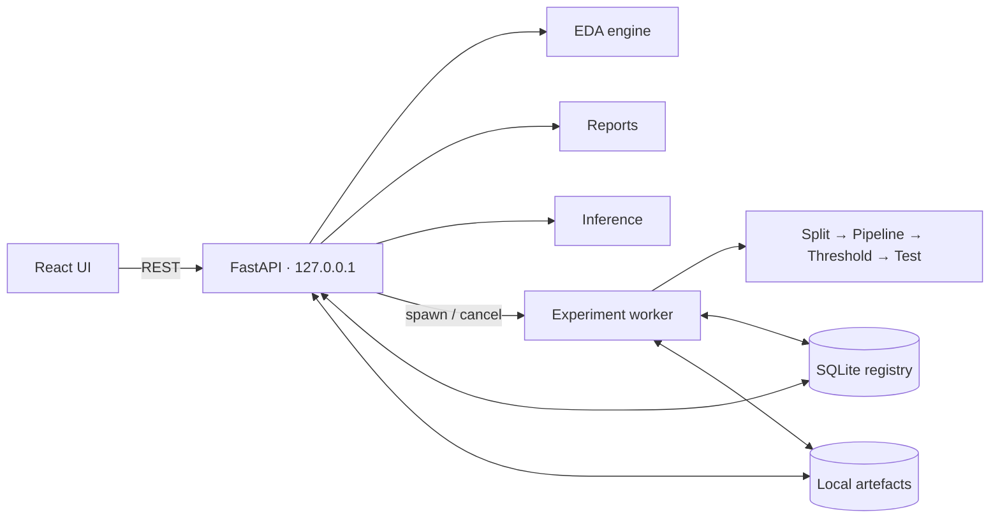

<div align="center">

# FinTech Anomaly Detection (FTAD)

**Local research platform for reproducible fraud and anomaly detection analysis, exploratory data analysis
and comparative machine-learning benchmarking.**

**Author / Maintainer:** Georg-Otto Wagner · **Version:** 1.0.0 · **Licence:** MIT

**Contact:** [georg-otto.wagner@outlook.com](mailto:georg-otto.wagner@outlook.com)


</div>


## Overview

Fraud and other financial anomalies are rare. A model that never raises an alert can be more than
99 % "accurate" and still catch nothing. FTAD is built for this situation: it guides an analyst from a
raw tabular file to a documented, leakage-safe comparison of detection methods, entirely on the
analyst's own machine.

FTAD was developed as a local research platform for reproducible fraud and anomaly detection analysis.
It is research software, not a production fraud-detection service.

| | |
|---|---|
| **Dataset ingestion** | CSV/Parquet upload with validation, SHA-256 fingerprint, duplicate detection and an immutable raw copy |
| **Schema mapping** | Suggested and editable column roles: target with explicit positive label, numeric, categorical, precomputed PCA components, time, transaction ID, entity ID, ignore |
| **Descriptive statistics & EDA** | Full-data statistics, class balance, value (amount) and time analysis, correlations, feature-separation indicators, generated findings |
| **Class-imbalance analysis** | Prevalence, imbalance ratio, majority-baseline accuracy and why accuracy misleads |
| **Supervised benchmarking** | 17 supervised algorithms, five imbalance strategies, configurable preprocessing |
| **Unsupervised anomaly detection** | Isolation Forest, Local Outlier Factor and One-Class SVM under the same protocol |
| **Threshold analysis** | Validation-frozen thresholds, Threshold Studio, confusion matrices, hypothetical cost simulator |
| **Reproducible protocols** | Stored split indices and hashes, seeds, configuration, library versions and fitted pipelines |
| **Research reports** | Markdown/HTML report, CSV tables, PNG/SVG figures and a JSON manifest |

## Key capabilities

- **Nothing is assumed.** No dataset is preloaded and no column names are hard-coded; every number on
  screen is computed from the uploaded file.
- **Leakage-safe evaluation.** Preprocessing and resampling are fitted on training rows only, thresholds
  are chosen on validation and frozen, and the test partition is scored once.
- **Rare-event metrics first.** Average precision (AP) is shown next to its random-ranking baseline
  (the prevalence); undefined metrics are shown as *n/a*, never as 0.
- **Reproducible by design.** Dataset fingerprint, schema hash, split indices, seeds, configuration and
  package versions are persisted with every experiment.
- **Local only.** The backend binds to `127.0.0.1`, makes no outbound network calls and bundles its fonts.

## Screenshots

All screenshots below use the clearly labelled **synthetic demo dataset** in [`demo/synthetic/`](demo/synthetic/).

| | |
|---|---|
|  |  |
|  |  |
|  |  |
|  |  |

## Quick start (macOS)

**Supported platform:** macOS only. Tested on macOS / Apple Silicon (Apple M3 Pro). Requirements:
[Homebrew](https://brew.sh), Python 3.12+, Node.js 20+ and the OpenMP runtime used by XGBoost and LightGBM.

```bash
brew install python@3.12 node libomp
git clone https://github.com/DrGeorgOttoWagner/fintech-anomaly-detection.git
cd fintech-anomaly-detection
./scripts/setup.sh      # Python virtualenv, backend dependencies, frontend build, .env
./scripts/start.sh      # → http://127.0.0.1:8790
```

To try FTAD without downloading anything, upload
[`demo/synthetic/synthetic_transactions.csv`](demo/synthetic/). Detailed instructions:
[docs/getting-started.md](docs/getting-started.md).

## Typical workflow

1. Start FTAD (`./scripts/start.sh`) and open `http://127.0.0.1:8790`.
2. Upload a dataset (CSV or Parquet).
3. Map the schema: target and positive label, features, time, value and identifier columns.
4. Inspect data quality: missing values, duplicates, class distribution.
5. Run the exploratory analysis: value, time, correlations and feature separation.
6. Configure the split: train/validation/test fractions, method and seed.
7. Run a benchmark (Quick, Full or hyperparameter optimisation).
8. Compare AP, precision, recall, F1 and ROC-AUC in the leaderboard.
9. Inspect thresholds and confusion matrices.
10. Export a research report.

See the [user guide](docs/user-guide.md), the generic [research workflow](docs/workflow.md) and the
[metrics guide](docs/metrics.md).

## Algorithms

FTAD v1.0.0 registers 20 algorithms (verified against `backend/ftad/core/models/registry.py`).

| Supervised (17) | | Unsupervised anomaly detection (3) |
|---|---|---|
| Dummy (majority class) | Gradient Boosting | Isolation Forest |
| Logistic Regression | HistGradientBoosting | Local Outlier Factor (novelty mode) |
| Ridge Classifier | XGBoost | One-Class SVM |
| SGD Classifier (log-loss) | LightGBM | |
| Linear Discriminant Analysis | CatBoost | |
| Decision Tree | k-Nearest Neighbours | |
| Random Forest | Gaussian Naive Bayes | |
| Extra Trees | SVM (RBF kernel) | |
| | Multi-Layer Perceptron | |

Each adapter declares its score type (probability, decision score or anomaly score), whether it needs
scaling, its class-weighting support and its resource caps. Imbalance strategies: none, class weighting,
random undersampling, random oversampling and SMOTE (training data only).

## Reproducible fraud-detection showcase

FTAD was applied to the public **Credit Card Fraud Detection** dataset (Machine Learning Group – ULB,
[Kaggle](https://www.kaggle.com/datasets/mlg-ulb/creditcardfraud)). The dataset is **not** distributed
with this repository.

- 284,807 transactions, 492 frauds, prevalence 0.1727 %
- 20 algorithms, 3 train/validation/test allocation profiles
- duplicate-leakage and chronological robustness checks

| Profile | Validation-selected model | Test AP |
|---|---|---:|
| 70/15/15 | CatBoost | 0.8415 |
| 80/10/10 | Extra Trees | 0.8901 |
| 60/20/20 | XGBoost | 0.8773 |

No universal winning algorithm was observed. CatBoost, XGBoost, Extra Trees and Random Forest
consistently formed the leading supervised group. Each profile has its own test set, so the higher
AP of the 80/10/10 profile does not make that allocation universally better.

→ **[examples/credit-card-fraud/](examples/credit-card-fraud/README.md)**: workflow, results, figures and tables.

## Architecture



```
fintech-anomaly-detection/
├── backend/ftad/        # FastAPI app and the domain-agnostic research engine
├── frontend/            # React + TypeScript + Vite UI, Playwright acceptance test
├── tests/backend/       # pytest unit and API integration tests
├── docs/                # getting started, user guide, workflow, metrics, architecture, reproducibility
├── examples/            # credit-card fraud research showcase (aggregate results only)
├── demo/synthetic/      # small synthetic demo dataset and its generator
└── scripts/             # setup / start / dev / test
```

Details: [docs/architecture.md](docs/architecture.md) · [docs/reproducibility.md](docs/reproducibility.md) ·
[docs/extending.md](docs/extending.md).

## Testing

```bash
./scripts/test.sh                        # backend pytest + frontend type-check + lint
cd frontend && npx playwright test       # browser acceptance workflow on a synthetic fixture
```

Test fixtures are synthetic and labelled as such; they are never presented as research results.

## Limitations (v1.0.0)

- Binary targets only (multi-class targets are binarised *positive vs. rest*); no regression or forecasting.
- Files are loaded fully into memory.
- Kernel SVM, k-NN, LOF, One-Class SVM and classic Gradient Boosting train on capped stratified subsamples by default.
- One train/validation/test split per experiment; no bootstrap confidence intervals or repeated-split evaluation yet.
- A model fit cannot be interrupted midway; cancelling terminates the worker process.
- macOS only.

## Technology

Python 3.12 · FastAPI · pandas · NumPy · SciPy · scikit-learn · imbalanced-learn · XGBoost · LightGBM ·
CatBoost · matplotlib · SQLite · React 19 · TypeScript · Vite · Tailwind CSS · Recharts · pytest · Playwright.

## Responsible use

FTAD's outputs are statistical associations and model scores, not decisions. An anomaly is not
necessarily fraud, a large amount is not by itself evidence of fraud, and model probabilities are not
calibrated unless calibration is enabled. Any operational use requires independent validation,
monitoring and human oversight.

## Licence

[MIT](LICENSE) © 2026 Georg-Otto Wagner. Third-party libraries keep their own licences. The Credit Card
Fraud Detection dataset is published by the Machine Learning Group – ULB under the Open Database
License (ODbL) and is not redistributed here.
