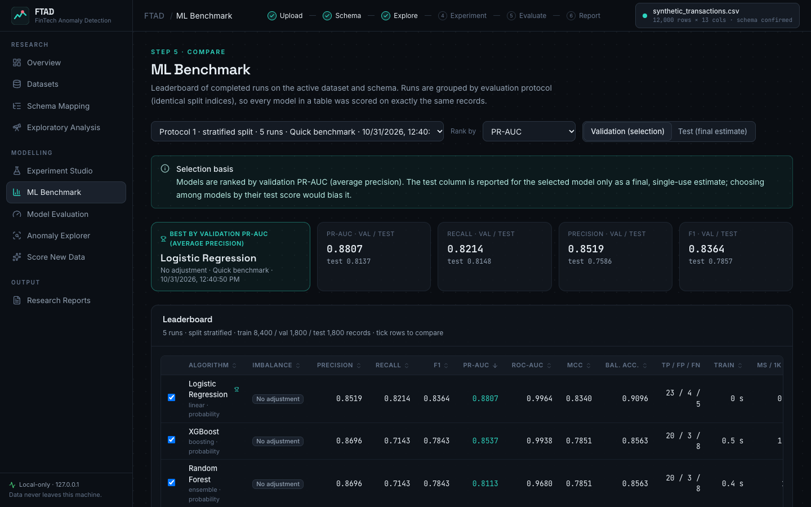
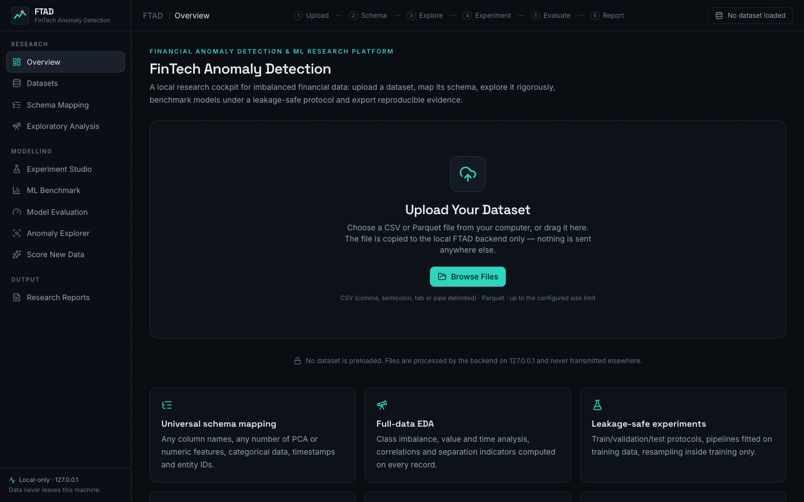
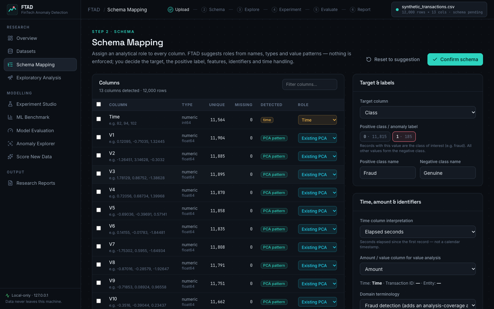
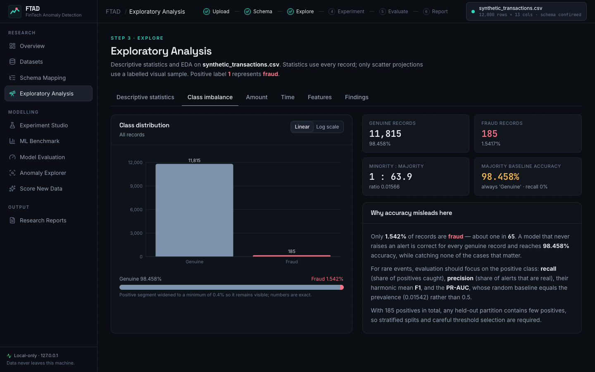
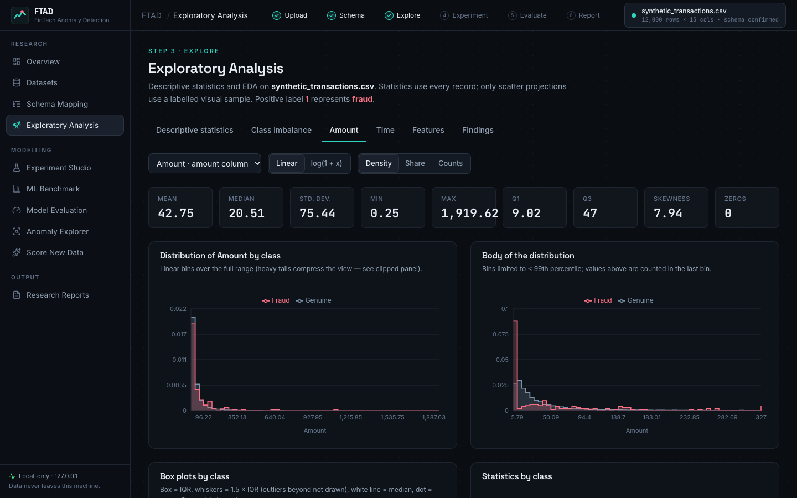
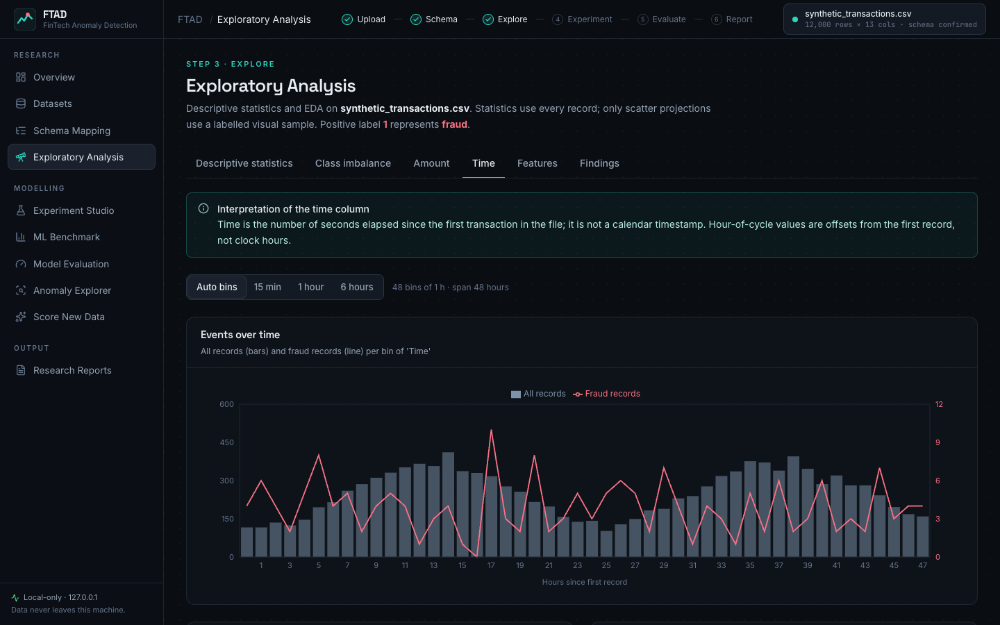
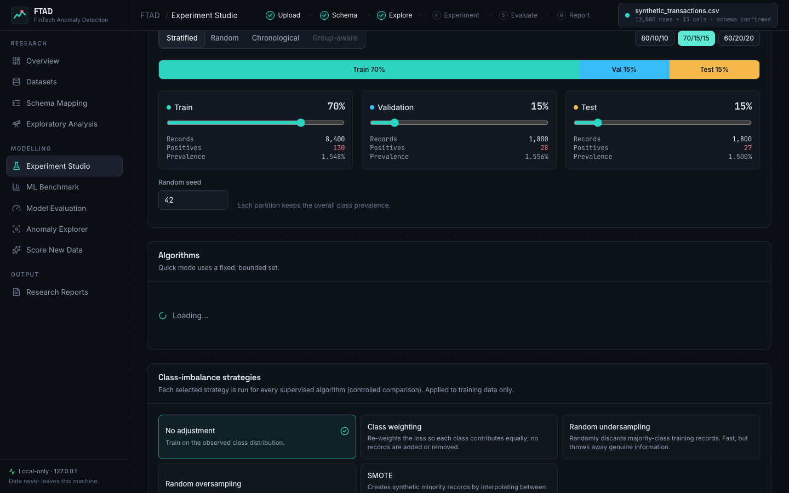
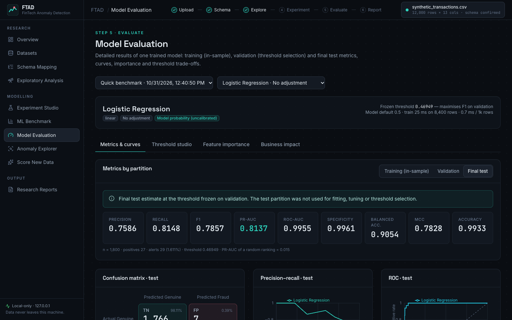
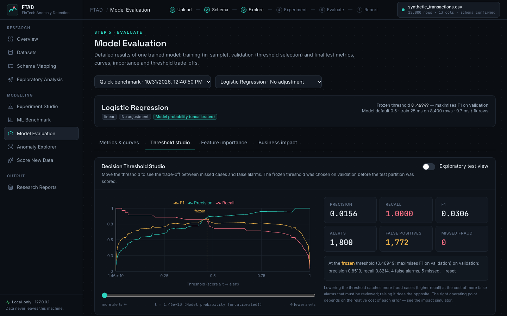
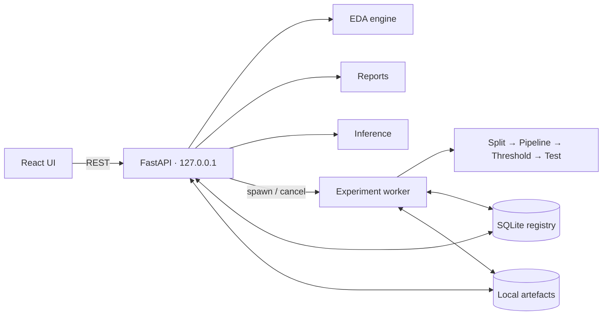

<div align="center">

# FTAD · FinTech Anomaly Detection

**A local research platform for financial anomaly detection and machine learning on imbalanced data.**

Upload a dataset → map its schema → explore it rigorously → benchmark models under a leakage-safe
protocol → inspect individual anomalies → export reproducible research evidence.


</div>



## Why FTAD

Fraud and other financial anomalies are rare. On the public credit-card fraud dataset, a model that
never raises an alert is 99.83 % "accurate" and useless. FTAD is built around that fact:

- **Nothing is assumed.** No dataset is preloaded, no column names are hard-coded, and every number
  on screen is computed from the file you upload.
- **Evaluation is honest.** One split per experiment, preprocessing and resampling fitted on training
  data only, thresholds chosen on validation and frozen, a single final test estimate, PR-AUC shown
  against its prevalence baseline, undefined metrics shown as *n/a* instead of 0.
- **Everything is reproducible.** Dataset SHA-256, schema hash, split indices, seeds, configuration,
  package versions and fitted pipelines are persisted and exportable.
- **Your data stays local.** The backend binds to `127.0.0.1`, makes no outbound calls and bundles its fonts.

## Features

| Area | Highlights |
|---|---|
| **Datasets** | Native file picker or drag & drop, upload progress, CSV/Parquet validation, SHA-256 fingerprint, duplicate detection, immutable raw copy, paged preview, dataset registry with explicit reopen |
| **Schema mapping** | Auto-detected types, missing/unique counts, identifiers, targets, timestamps and precomputed-PCA patterns; editable roles (target, numeric, categorical, existing PCA, time, transaction ID, entity ID, ignore); explicit positive label; live validation |
| **Exploratory analysis** | Prevalence, imbalance ratio, majority-baseline accuracy; amount distributions (linear/log, box plots, tests, deciles); temporal volume and positive rate; correlation heatmaps; KS/AUC/MI relevance; class-conditional distributions; PCA component properties; generated findings |
| **Experiment studio** | Quick / Full / HPO modes; linked train/validation/test sliders with presets; stratified, random, chronological and group-aware splits; 20 algorithms; 5 imbalance strategies; configurable preprocessing; threshold policies; async worker with progress and cancellation |
| **Benchmark & evaluation** | Leaderboard per evaluation protocol ranked by a validation objective; PR/ROC/calibration curves; confusion matrices; native & permutation importance; Threshold Studio; hypothetical cost simulator |
| **Anomaly explorer** | TP/FP/TN/FN filters, scores and thresholds per record, feature values, CSV export |
| **Score new data** | Apply persisted pipelines to new uploads with compatibility checks (missing columns, types, unseen categories, PCA provenance & drift) |
| **Research reports** | Markdown + HTML report, CSV tables, PNG/SVG figures, manifest, analysis-coverage appendix; ZIP download or export to a configured local folder |

### Model registry

| Family | Algorithms |
|---|---|
| Baseline | Dummy (majority class) |
| Linear | Logistic Regression · Ridge Classifier · SGD (log-loss) · Linear Discriminant Analysis |
| Trees & ensembles | Decision Tree · Random Forest · Extra Trees · Gradient Boosting · HistGradientBoosting |
| Boosting libraries | XGBoost · LightGBM · CatBoost |
| Other supervised | k-Nearest Neighbours · Gaussian Naive Bayes · SVM (RBF) · Multi-Layer Perceptron |
| Anomaly detection | Isolation Forest · Local Outlier Factor (novelty) · One-Class SVM |

Each adapter declares its score type (*probability*, *decision score* or *anomaly score*), whether it
needs scaling, how it supports class weighting and its resource caps. Unavailable libraries and
inapplicable strategy combinations are reported, never silently substituted. Every one of the 20
adapters is individually validated by the test suite (fit → score → frozen threshold → metrics →
persisted pipeline).

## Screenshots

| | |
|---|---|
|  |  |
|  |  |
|  |  |
|  |  |

Screenshots show a synthetic demo dataset.

## Example: Quick Benchmark on the public credit-card fraud dataset

One run of the built-in Quick Benchmark on `creditcard.csv` (284,807 transactions, 492 frauds,
stratified 70/15/15 split, seed 42, no resampling, threshold maximising F1 on validation). Test
partition: 42,722 records with 74 frauds. Produced by FTAD itself; reproduce it with the steps below.

| Model | Precision | Recall | F1 | ROC-AUC | PR-AUC |
|---|---|---|---|---|---|
| Dummy (majority class) | n/a | 0.000 | 0.000 | 0.500 | 0.002 |
| Logistic Regression | 0.775 | 0.743 | 0.759 | 0.958 | 0.751 |
| Random Forest | 0.951 | 0.784 | 0.859 | 0.937 | 0.834 |
| XGBoost | 0.950 | 0.770 | 0.851 | 0.970 | 0.834 |
| Isolation Forest (unsupervised) | 0.367 | 0.243 | 0.293 | 0.942 | 0.223 |

Note the Isolation Forest row: a high ROC-AUC can coexist with poor alert quality under extreme
imbalance — which is why FTAD ranks by PR-AUC on validation by default. With only 74 test frauds,
differences of a few cases change these numbers noticeably.

## Architecture



```
FTAD/
├── backend/ftad/
│   ├── core/            # domain-agnostic research engine
│   │   ├── data/  schema/  eda/  splitting/  preprocessing/  imbalance/
│   │   ├── models/  evaluation/  experiments/  inference/  reporting/
│   │   └── interfaces.py   # extension points
│   ├── modules/fraud/   # fraud-domain hints, cost model, evidence matrix
│   └── api/             # FastAPI routers
├── frontend/            # React + TypeScript + Vite + Tailwind + Recharts
├── tests/backend/       # pytest unit & API integration tests
├── frontend/e2e/        # Playwright browser acceptance test
├── docs/                # architecture, user guide, reproducibility, extending
└── scripts/             # setup / start / dev / test
```

Details: [docs/ARCHITECTURE.md](docs/ARCHITECTURE.md).

## Installation

Requirements: Python 3.12+, Node.js 20+, and on macOS the OpenMP runtime for XGBoost/LightGBM
(`brew install libomp`).

```bash
git clone https://github.com/<you>/fintech-anomaly-detection.git
cd fintech-anomaly-detection
./scripts/setup.sh
```

## Running

```bash
./scripts/start.sh          # → http://127.0.0.1:8790
```

Development mode with hot reload (API :8790, UI :5173): `./scripts/dev.sh`.
Configuration lives in `.env` (see [.env.example](.env.example)): port, data directory, upload limit
and the optional `FTAD_EXPORT_DIR` for one-click report export.

## Using FTAD

1. **Upload** a CSV or Parquet file with *Browse Files* (e.g. `creditcard.csv` from
   [Kaggle: mlg-ulb/creditcardfraud](https://www.kaggle.com/datasets/mlg-ulb/creditcardfraud) — download it yourself; FTAD never downloads data).
2. **Map the schema**: confirm the target and its positive label, features, time and identifier columns.
3. **Explore**: descriptive statistics, class imbalance, amount and time analysis, features, findings.
4. **Configure an experiment**: split sliders, mode, algorithms, imbalance strategies, preprocessing, threshold policy.
5. **Run a benchmark** and follow its progress; compare runs in the **ML Benchmark** leaderboard.
6. **Interpret**: confusion matrices, curves, Threshold Studio, importance, cost scenarios, record-level explorer.
7. **Export** a research report bundle.

See the [user guide](docs/USER_GUIDE.md) for every screen and for guidance on interpreting results.

## Reproducing results

Experiments store dataset fingerprint, schema hash, split indices, seeds, configuration, package
versions and fitted pipelines. `Reproduce` re-runs an experiment identically; manifests are exported
with every report. See [docs/REPRODUCIBILITY.md](docs/REPRODUCIBILITY.md).

## Testing

```bash
./scripts/test.sh                       # pytest (backend) + type-check + lint (frontend)
cd frontend && npx playwright test      # browser acceptance workflow on a synthetic fixture
FTAD_E2E_DATASET=/path/to/creditcard.csv npx playwright test   # same workflow on real data
```

Test fixtures are synthetic and labelled as such; they are never presented as research results.
The browser suite runs against its own temporary data directory and port.

## Extending

New models (including PyTorch networks wrapped as scikit-learn estimators), split strategies
(walk-forward, purged temporal CV), schema hints and report sections plug in through registries —
see [docs/EXTENDING.md](docs/EXTENDING.md).

## Known limitations

- Binary targets only (multi-class targets are binarised *positive vs. rest*); no regression/forecasting yet.
- Very large files are loaded fully into memory (the 144 MB Kaggle file uses ≈70 MB in memory).
- Kernel SVM, kNN, LOF, One-Class SVM and classic Gradient Boosting train on capped stratified subsamples by default.
- Training cannot be interrupted inside a single model fit; cancellation terminates the worker process.
- Test metrics on datasets with few positives are uncertain; FTAD does not yet report bootstrap confidence intervals.
- The optional PyTorch autoencoder is not included in v1.0 (extension point documented).

## Roadmap

- Bootstrap confidence intervals and repeated-split evaluation
- Walk-forward / expanding-window / purged temporal cross-validation
- PyTorch autoencoder and custom neural-network adapters
- Regression and forecasting tasks; multivariate time-series windows
- Out-of-core processing for datasets larger than memory
- SHAP-style local explanations in the Anomaly Explorer

## Responsible use

FTAD is a research tool. Its outputs are statistical associations and model scores, not decisions.
An anomaly is not necessarily fraud; large amounts are not by themselves evidence of fraud; model
probabilities are not calibrated unless explicitly calibrated. Any operational use requires
independent validation, monitoring and human oversight.

## License

[MIT](LICENSE). The Credit Card Fraud Detection dataset is published by the Machine Learning Group
of ULB under the Open Database License (ODbL) and is not redistributed here.
