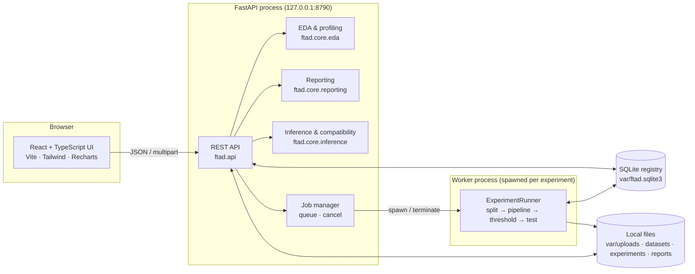

# Architecture

FTAD is a single-machine application: one FastAPI process serves the REST API and the built
React UI; model training runs in a separate worker process. Everything binds to `127.0.0.1`.

> **Data remains local to the analyst's machine.** Uploaded files, parsed datasets, models, scores and
> reports are written only to the local data directory (`FTAD_DATA_DIR`, default `var/`). FTAD makes no
> outbound network calls, sends no telemetry and bundles its fonts.



## Backend packages

| Package | Responsibility |
|---|---|
| `ftad.core.data` | Safe ingestion (size/type/signature checks, sanitised names, SHA-256), read-only raw copy, normalised Parquet frame, dataset registry, active session |
| `ftad.core.schema` | Column profiling, role suggestions (hint providers), `SchemaConfig`, validation, target encoding |
| `ftad.core.eda` | Descriptive statistics, class balance, value/time analysis, correlations, relevance indicators, PCA properties, projection, generated findings |
| `ftad.core.splitting` | Split strategies (stratified, random, chronological, group) behind a registry; validity checks |
| `ftad.core.preprocessing` | `ColumnTransformer` pipelines (imputation, scaling, log transform, encoding, optional PCA/feature selection) |
| `ftad.core.imbalance` | Samplers inserted into an imbalanced-learn pipeline (training only) |
| `ftad.core.models` | Model registry — adapters around scikit-learn, XGBoost, LightGBM, CatBoost with score types and resource caps |
| `ftad.core.evaluation` | Metrics from predictions, curves, threshold sweep and policies |
| `ftad.core.experiments` | Experiment config, planning (algorithm × strategy), worker runner, job manager, manifests |
| `ftad.core.inference` | Loading persisted pipelines, compatibility checks, scoring |
| `ftad.core.reporting` | Figure generation (PNG/SVG), Markdown/HTML documents, bundles |
| `ftad.modules.fraud` | Fraud-domain hints, hypothetical cost model, analysis-coverage report appendix |
| `ftad.api` | FastAPI routers |

Fraud-specific logic lives only in `ftad.modules.fraud`; the core never references fraud,
Kaggle column names or V1–V28.

## Experiment protocol

1. The split is computed once per experiment from the seed, verified to be disjoint, and its
   indices are stored (`split.npz`) with a SHA-256 hash.
2. For each algorithm × imbalance strategy, an `imblearn.Pipeline` of
   *preprocessing → (sampler) → estimator* is fitted **on training rows only**. Samplers only
   run during `fit`, so validation/test keep the original prevalence.
3. In HPO mode, `RandomizedSearchCV` runs on the training partition (stratified or time-series
   folds). The pipeline including the sampler is cross-validated, so resampling happens inside
   training folds.
4. Scores are computed for train/validation/test; the threshold is selected on validation by the
   configured policy and frozen.
5. Test metrics are computed once at the frozen threshold.
6. The fitted pipeline, threshold, feature schema, training statistics and package versions are
   persisted (`model.joblib`); scores, curves and sweeps are stored for the UI.

## Persistence layout (`FTAD/var`, git-ignored)

```
var/
├── ftad.sqlite3                 datasets, schemas, experiments, runs, app state
├── uploads/<sha256>/<file>      immutable raw upload (read-only)
├── datasets/<id>/frame.parquet  parsed frame used by all analyses
├── experiments/<exp>/           split.npz, manifest.json, <run>/model.joblib, scores.npz, detail.json
├── predictions/                 inference outputs
└── reports/<rep>/               report.md/html, tables/*.csv, figures/*.png|svg, manifest.json
```

## Frontend

React 19 + TypeScript, built with Vite, styled with Tailwind CSS, charts with Recharts. In production
the built UI (`frontend/dist`) is served by the FastAPI process; in development Vite serves it on
:5173 and proxies `/api`. Each page corresponds to one workflow step (Overview, Datasets, Schema
Mapping, Exploratory Analysis, Experiment Studio, ML Benchmark, Model Evaluation, Anomaly Explorer,
Score New Data, Research Reports).

## Security & privacy

- Loopback binding plus `TrustedHostMiddleware` (DNS-rebinding guard); CORS only for the local dev server.
- Uploads: extension allow-list, content signature check, size limit, streaming hash, content-addressed
  storage (client filenames never form paths), read-only raw copy. Files are parsed, never executed.
- Report file serving and exports resolve paths and refuse anything outside the report directory;
  exports only go to the folder configured in `FTAD_EXPORT_DIR`.
- No telemetry, no external network calls, fonts bundled locally.
