# Results

All values come from the frozen FTAD study outputs and are rounded to four decimals. The CSV
files in [tables/](tables/) hold the same values.

## 1. Dataset

| Property | Value |
|---|---|
| Transactions | 284,807 |
| Columns | 31 |
| Frauds / genuine | 492 / 284,315 |
| Fraud prevalence | **0.1727 %** |
| Genuine : fraud | ≈ 578 : 1 |
| Missing cells | 0 |
| Exact duplicate rows beyond first occurrence | 1,081 (773 groups, 1,854 rows involved, 19 of them fraudulent) |
| Elapsed time | 0–172,792 s (≈ 48 h) |

**The accuracy trap:**

- A classifier that labels every transaction as genuine reaches **99.8273 % accuracy** with
  **fraud recall 0**.
- The meaningful baseline is the AP of a random ranking, **0.0017**.

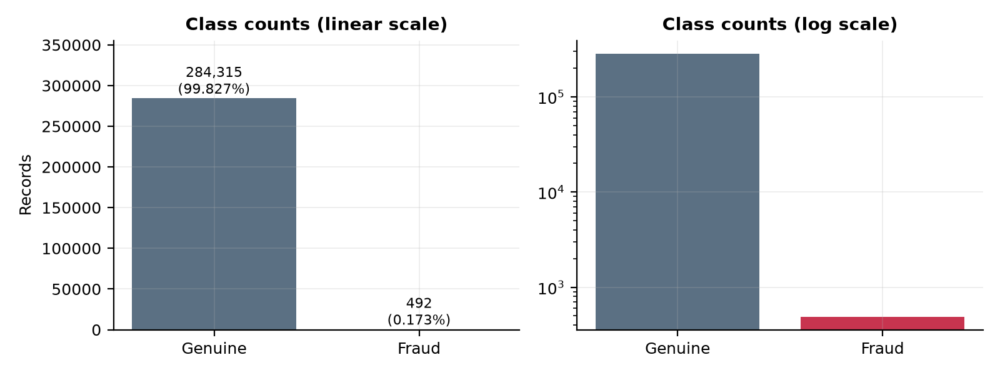

## 2. Exploratory findings

### Amount

The amount distribution is strongly right-skewed:

- mean 88.35, median 22.00, skewness 16.98;
- maximum 25,691.16.

Fraudulent transactions have a lower median than genuine ones (9.25 vs. 22.00) but a higher mean
(122.21 vs. 88.29).

**The relation to fraud is not monotonic.** Fraud rates by amount decile
([table](tables/amount_decile_fraud_rate.csv)):

| Decile band | Amount range | Fraud rate |
|---|---|---:|
| 1 | 0.00–1.00 | 0.405 % |
| 2 | 1.00–3.57 | 0.351 % |
| 4–7 | 8.91–59.80 | 0.046–0.084 % |
| 10 | 203.00–25,691.16 | 0.298 % |

The lowest and highest bands have higher fraud rates than the middle range. Even so, every band is
more than 99.5 % genuine, so **`Amount` alone is weak evidence of fraud**.

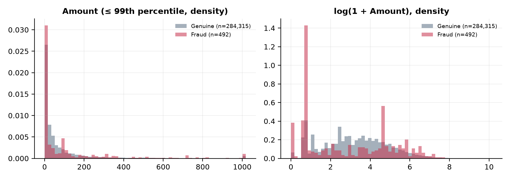

### Time

The data span about 48 hours, with two day-like cycles of volume.

- **Hourly fraud rate:** between 0.000 % and 2.055 % ([table](tables/hourly_activity.csv)).
- **Low-volume hours have a higher observed fraud rate:** hours with below-median volume pool to
  0.257 %, against 0.136 % in busier hours.
- **What can't be inferred:** `Time` is an offset, so clock time, weekday and seasonality cannot be
  derived, and two days are too few to confirm recurring patterns.

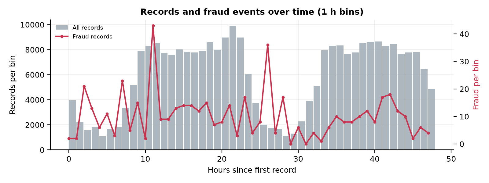

### Anonymised components

The strongest univariate separation is in **V14 (KS 0.84), V10 (0.80), V12 (0.78), V4 (0.77) and V11
(0.76)** ([table](tables/feature_separation.csv)). These are anonymised principal components, so no
business meaning can be attached to them.

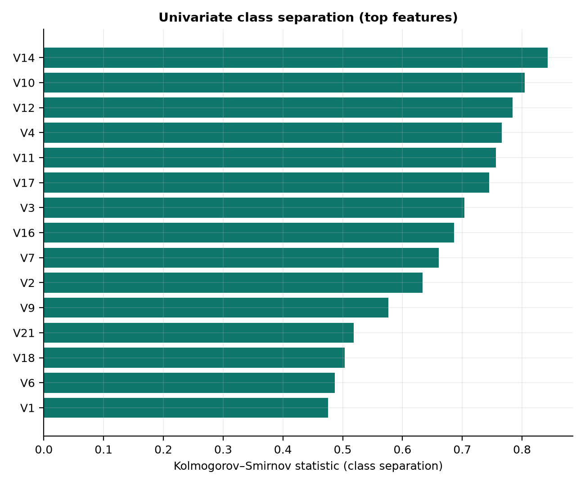

## 3. 20-algorithm benchmark (profile A, stratified 70/15/15)

Test set: 42,722 transactions with 74 frauds. Thresholds are frozen on validation.

- Rows are ordered by validation AP, the selection basis. Test values are single-use estimates.
- \* = trained on a capped stratified subsample.
- Full table: [benchmark_profile_A_all_algorithms.csv](tables/benchmark_profile_A_all_algorithms.csv).

### Supervised

| Algorithm | Val. AP | Test AP | Precision | Recall | F1 | ROC-AUC |
|---|---:|---:|---:|---:|---:|---:|
| CatBoost | 0.8349 | 0.8415 | 0.9333 | 0.7568 | 0.8358 | 0.9667 |
| XGBoost | 0.8282 | 0.8359 | 0.8824 | 0.8108 | 0.8451 | 0.9732 |
| Random Forest | 0.8181 | 0.8258 | 0.9385 | 0.8243 | 0.8777 | 0.9366 |
| Extra Trees | 0.8170 | 0.8382 | 0.9254 | 0.8378 | 0.8794 | 0.9429 |
| Multi-Layer Perceptron | 0.7965 | 0.8158 | 0.8923 | 0.7838 | 0.8345 | 0.9602 |
| k-Nearest Neighbours* | 0.7634 | 0.7833 | 0.9310 | 0.7297 | 0.8182 | 0.9187 |
| Decision Tree | 0.7314 | 0.7423 | 0.9273 | 0.6892 | 0.7907 | 0.8828 |
| Logistic Regression | 0.6704 | 0.7499 | 0.8154 | 0.7162 | 0.7626 | 0.9565 |
| Ridge Classifier | 0.6385 | 0.7558 | 0.8939 | 0.7973 | 0.8429 | 0.9635 |
| SVM (RBF)* | 0.6270 | 0.7281 | 0.7273 | 0.7568 | 0.7417 | 0.9474 |
| Linear Discriminant Analysis | 0.6237 | 0.7411 | 0.8939 | 0.7973 | 0.8429 | 0.9635 |
| SGD Classifier (log-loss) | 0.6141 | 0.7474 | 0.7846 | 0.6892 | 0.7338 | 0.9662 |
| Gradient Boosting* | 0.4613 | 0.6122 | 0.7733 | 0.7838 | 0.7785 | 0.8774 |
| LightGBM | 0.3015 | 0.2906 | 0.4940 | 0.5541 | 0.5223 | 0.7973 |
| Gaussian Naive Bayes | 0.1694 | 0.1718 | 0.2385 | 0.4189 | 0.3039 | 0.9606 |
| Dummy (majority class) | 0.0017 | 0.0017 | n/a | 0.0000 | 0.0000 | 0.5000 |
| HistGradientBoosting | 0.0017 | 0.0017 | 0.0017 | 1.0000 | 0.0035 | 0.4998 |

### Unsupervised anomaly detection

| Algorithm | Val. AP | Test AP | Precision | Recall | F1 | ROC-AUC |
|---|---:|---:|---:|---:|---:|---:|
| Isolation Forest | 0.1348 | 0.1517 | 0.2609 | 0.2432 | 0.2517 | 0.9476 |
| One-Class SVM* | 0.1179 | 0.1472 | 0.1951 | 0.4324 | 0.2689 | 0.9356 |
| Local Outlier Factor* | 0.0101 | 0.0069 | 0.0000 | 0.0000 | 0.0000 | 0.7529 |

**Reading the tables:**

- **The leading supervised group** is CatBoost, XGBoost, Extra Trees and Random Forest.
  - Test AP 0.83–0.84.
  - At the frozen thresholds, they detect 56–62 of 74 test frauds with 4–8 false alarms.
- **ROC-AUC flatters weak models.** Gaussian Naive Bayes reaches 0.96 ROC-AUC with an AP of only 0.17.
  Isolation Forest reaches 0.95 ROC-AUC with an AP of 0.15.
- **Three default configurations were unstable** (see [Limitations](#limitations)):
  - HistGradientBoosting collapsed to prevalence-level scores in profiles A and C;
  - LightGBM's test AP varied between 0.29 and 0.87 across profiles;
  - classic Gradient Boosting's varied between 0.16 and 0.61.

  These are properties of the tested default configurations, not of the algorithms in general.

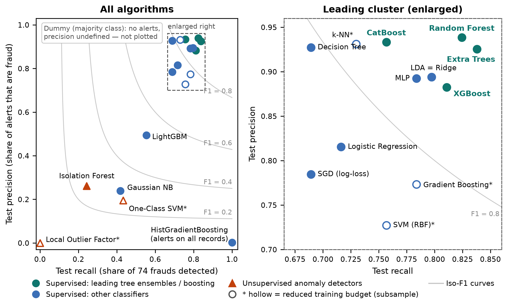

The confirmatory five-model benchmark (same partitions) selected **XGBoost** by validation AP:
test AP 0.8359, ROC-AUC 0.9732, precision 0.8824, recall 0.8108. That selection rule was fixed in advance.

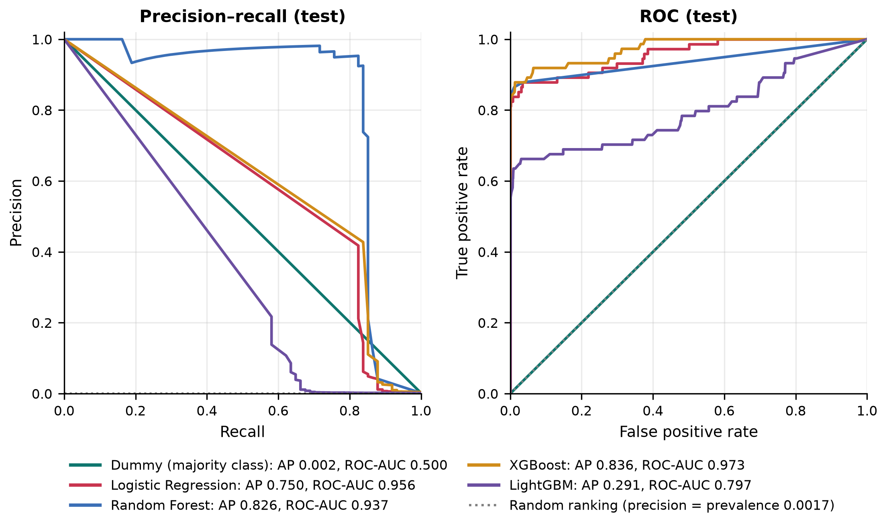

## 4. Three allocation profiles

| Profile | Validation-selected supervised model | Val. AP | Test AP | Precision | Recall | Test frauds |
|---|---|---:|---:|---:|---:|---:|
| A — 70/15/15 | CatBoost | 0.8349 | 0.8415 | 0.9333 | 0.7568 | 74 |
| B — 80/10/10 | Extra Trees | 0.8658 | 0.8901 | 0.9333 | 0.8571 | 49 |
| C — 60/20/20 | XGBoost | 0.8267 | 0.8773 | 0.8925 | 0.8384 | 99 |

Test AP of the leading group in each profile ([three_profile_comparison.csv](tables/three_profile_comparison.csv)):

| Algorithm | A | B | C |
|---|---:|---:|---:|
| CatBoost | 0.8415 | 0.9121 | 0.8717 |
| XGBoost | 0.8359 | 0.8987 | 0.8773 |
| Extra Trees | 0.8382 | 0.8901 | 0.8765 |
| Random Forest | 0.8258 | 0.8862 | 0.8782 |

**Interpretation:**

- **The same four models lead everywhere.** In every profile they have the four highest test AP values.
- **No universal winner.** The model selected by validation AP changes from profile to profile.
- **Profile B is not the "best" allocation.** Test AP is higher in profile B for most models, but each
  profile has its own validation and test set, and B's test set is the smallest (49 frauds). One fraud
  case changes recall by 1.0–2.0 percentage points, depending on the profile.

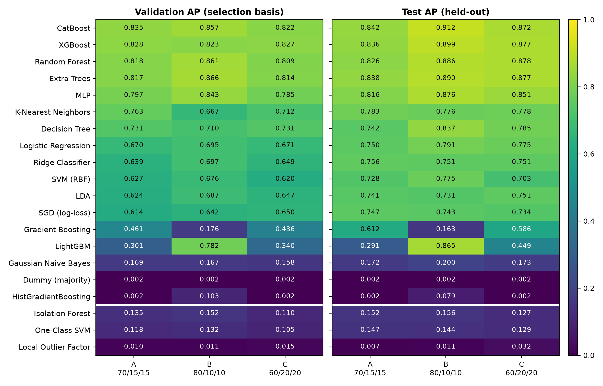

| | |
|---|---|
| 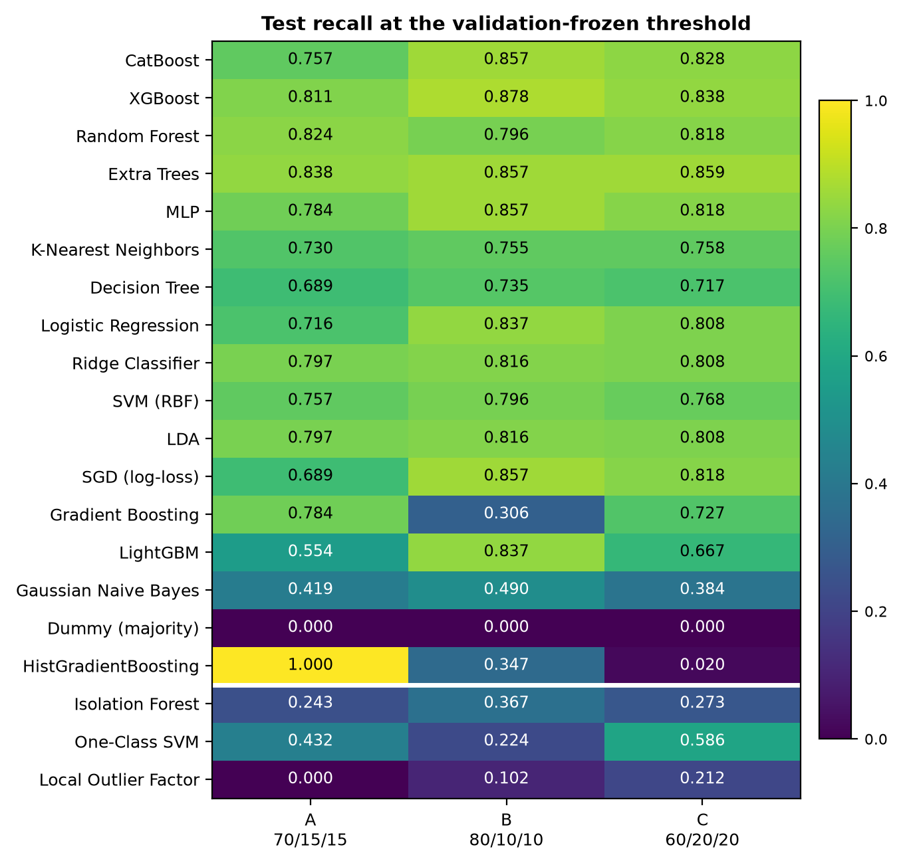 | 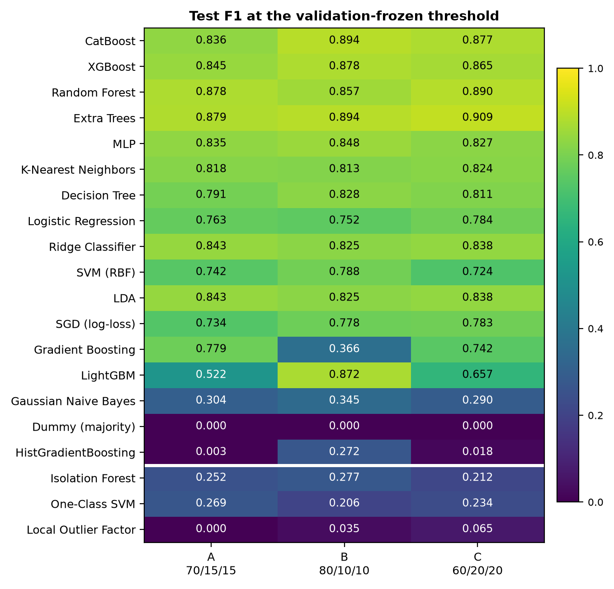 |

## 5. Supervised vs. unsupervised

| Profile A test AP | |
|---|---:|
| CatBoost | 0.8415 |
| Extra Trees | 0.8382 |
| XGBoost | 0.8359 |
| Random Forest | 0.8258 |
| Isolation Forest | 0.1517 |
| One-Class SVM | 0.1472 |
| Local Outlier Factor | 0.0069 |

On this labelled dataset, supervised models substantially outperform generic unsupervised anomaly
detection. The best detector, Isolation Forest, detects 18 of 74 test frauds at the cost of 51 false alarms.

This finding is limited to this dataset and these detector settings: fraud here is not simply "unusual".
It says nothing about settings where labels are missing or delayed.

## 6. Duplicate sensitivity

In the stratified splits, exact duplicate rows can fall into different partitions.

- **How many cross:** between 172 and 271 test records (3–5 frauds) have an identical copy in training,
  depending on the profile.
- **Removing them from the test set** lowers test AP only modestly. For example, CatBoost in profile A
  drops from 0.8415 to 0.8339, and XGBoost from 0.8359 to 0.8282.
- **Duplicate-safe group splits** keep identical rows together. They change AP more, in both directions.
  For example, XGBoost in profile A reaches 0.7300 and Extra Trees 0.8207. This partly reflects
  removed leakage, but the partitions themselves also change: profile A's test set has 68 instead of
  74 frauds.

The effect of duplicates therefore cannot be separated cleanly from ordinary split-to-split variation.
Full values: [duplicate_sensitivity.csv](tables/duplicate_sensitivity.csv) and
[duplicate_leakage_by_profile.csv](tables/duplicate_leakage_by_profile.csv).

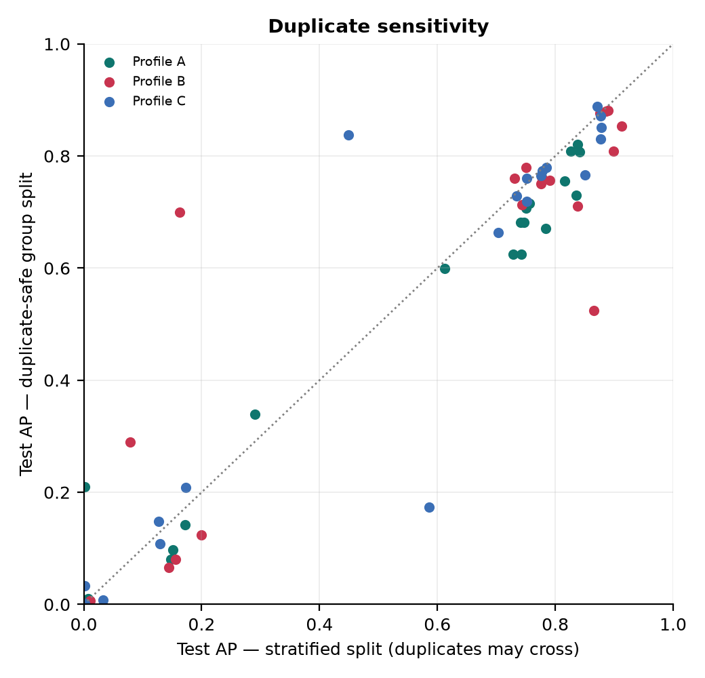

## 7. Temporal robustness

Chronological 70/15/15 split (train 0–36.9 h, validation 36.9–42.0 h, test 42.0–48.0 h). It is compared
with a stratified reference, both using 29 features (`Time` is not an input).

| XGBoost | AP | Precision | Recall | Test frauds |
|---|---:|---:|---:|---:|
| Stratified reference | 0.8353 | 0.9500 | 0.7703 | 74 |
| Chronological | 0.7533 | 0.9459 | 0.6731 | 52 |

**What it shows:**

- Performance on the latest period was lower, consistent with a shift in the data over time.
- The fraud prevalence also fell from 0.193 % in training to 0.122 % in the test period.

**Caveats:**

- The evidence is limited: about 48 hours of data and 52 test frauds.
- It is illustrative, not a general estimate of temporal decay.

See [temporal_robustness.csv](tables/temporal_robustness.csv).

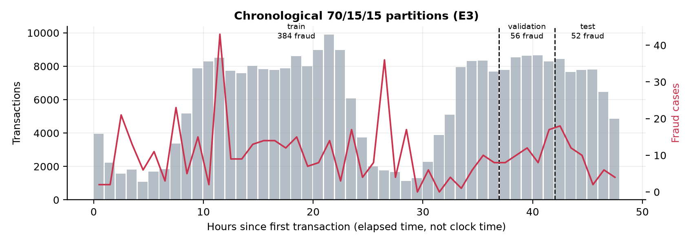

## 8. Computational cost

Profile A, single measurements, Apple M3 Pro, at most 10 threads per model
([computational_efficiency_profile_A.csv](tables/computational_efficiency_profile_A.csv)):

| Algorithm | Training rows | Training time |
|---|---:|---:|
| XGBoost | 199,364 | 2.56 s |
| Extra Trees | 199,364 | 4.40 s |
| CatBoost | 199,364 | 4.86 s |
| Random Forest | 199,364 | 32.58 s |
| Gradient Boosting | 120,000 (capped) | 138.25 s |

Gradient Boosting, k-NN (50,000 rows), SVM (20,000), LOF (30,000) and One-Class SVM (10,000) used
capped training budgets. Their times and scores are not directly comparable with full-data models.

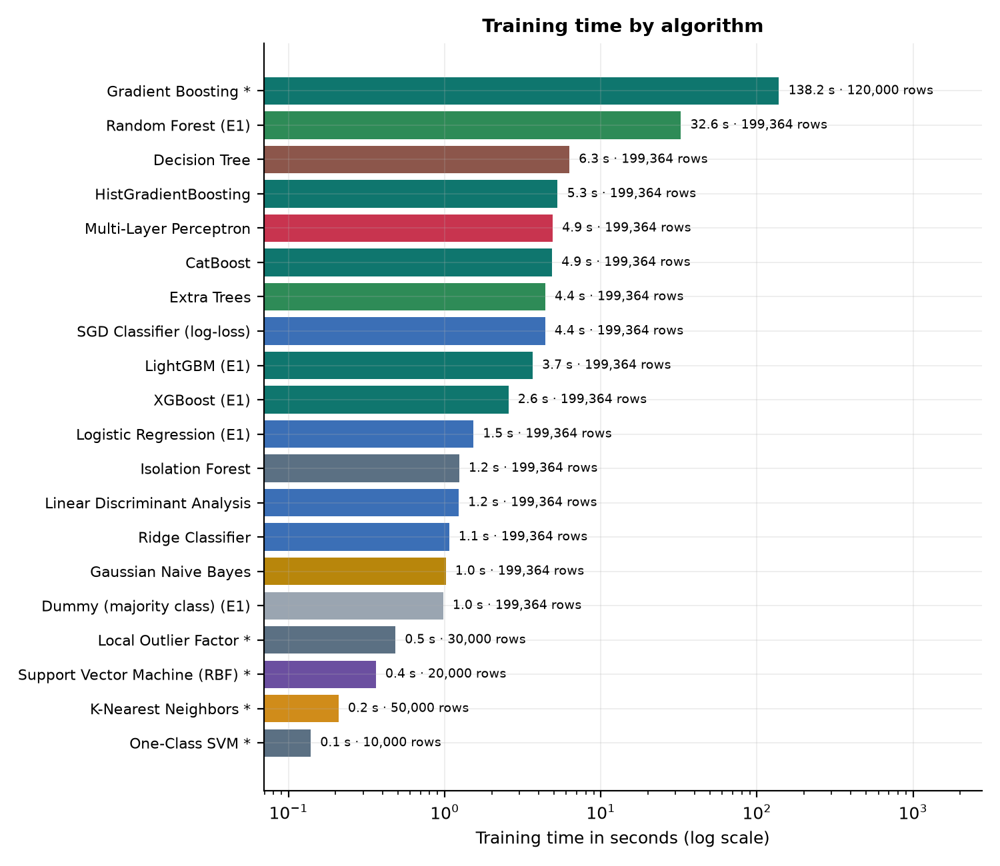

## Limitations

- **Data:**
  - about 48 hours of data, from 2013;
  - one data source;
  - no seasonality or current fraud patterns;
  - 28 of 30 inputs are anonymised, so findings about them cannot be interpreted in business terms.
- **Imbalance:** extreme class imbalance with small test fraud counts (49–99); one fraud case moves
  recall by 1.0–2.0 points.
- **Statistical uncertainty:**
  - one split per profile;
  - no confidence intervals, repeated splits or significance tests;
  - within each profile the leading group spans at most about 0.03 AP, less than the same model varies
    across profiles (e.g. CatBoost: 0.84–0.91).
- **Model settings:**
  - fixed default hyperparameters, with no tuning;
  - three default configurations proved unstable (HistGradientBoosting, LightGBM, classic Gradient Boosting);
  - five resource-intensive models used capped training subsamples.
- **Thresholds:** max-F1 on validation is a reproducible operating point, not a cost-optimal one.
  Real deployments must weigh missed fraud against review capacity.
- **Temporal robustness:** limited evidence (one chronological split over about 48 hours).
- **Labels:** taken as given; in practice they become available only after investigation and with delay.

Further work would add:

- repeated stratified or bootstrap evaluation with confidence intervals;
- cost-sensitive threshold selection;
- calibration;
- walk-forward validation on longer periods.
